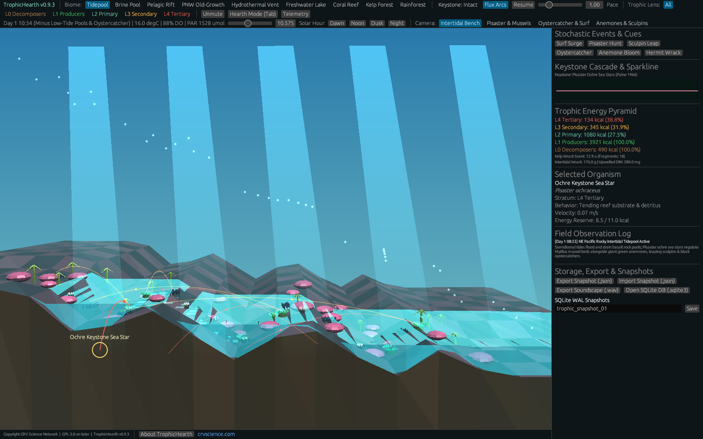

# TrophicHearth (`trophic-hearth` v0.9.3)

A 9-biome standalone safe-Rust (`#![forbid(unsafe_code)]` library core) **3D Trophic Diorama, Fire-Pit Hearth, & Bioacoustic Ecosystem Simulator** featuring **Coupled Rosenzweig-MacArthur Trophic ODEs**, **Interactive Keystone Trophic Cascades** (with live rolling `L1`–`L4` biomass sparklines), and **Calm 3D Food-Web Energy-Flux Arcs** (`L0 -> L1 -> L2 -> L3 -> L4`).

- **Documentation**: [User Guide](docs/USER_GUIDE.md) · [Scientific Methods](docs/SCIENTIFIC_METHODS.md) · [Preprints](Preprints/README.md)
- **Website**: [CRV Science Network](https://crvscience.com) · [CRV Science Public Apps](https://crvscience.com/apps)
- **License**: GNU General Public License v3.0 or later (`GPL-3.0-or-later`, see [LICENSE](LICENSE))



---

## Build & Run Quickstart

```bash
# Build & launch GUI (default: NE Pacific Rocky Intertidal Tidepool)
cargo run --release
cargo run --release -- --biome brine --hearth-mode

# Run a headless diurnal ecological sweep to JSON
cargo run --release -- simulate --biome vent --hours 12 --output vent_sim.json

# Synthesize an 18-second stereo 44.1 kHz bioacoustic soundscape WAV
cargo run --release -- export-wav --seconds 18 --output soundscape.wav

# Run trophic cascade resilience & keystone perturbation sensitivity sweep (JSON + CSV)
cargo run --release -- cascade-sweep --seconds 12 --out-dir exports

# Render an offscreen 1600x1000 PNG screenshot (1=Tidepool, 2=Coral Reef, 3=Vent)
cargo run --release -- --headless-screenshot validation/headless_screenshot.png --screenshot-view 1

# Run full unit and integration test suite
cargo test --all-targets
```

> Headless builds without hardware audio dependencies: `cargo build --release --no-default-features`.

---

## Interactive Controls & Hotkeys

All single-key shortcuts are guarded by `!ctx.wants_keyboard_input()`, so typing in the SQLite snapshot name box never triggers toggles.

| Input / Hotkey | Action |
| :--- | :--- |
| `1`, `2`, `3`, `4` | Smoothly glide camera between the 4 presets (`Side Diorama`, `Macro`, `Canopy/Apex`, `Substrate/Decomposer`) |
| `0` | Reset Trophic Lens to `AllStrata` |
| `Shift+0` .. `Shift+4` | Focus single trophic stratum (`Shift+0` = `L0`, `Shift+1` = `L1`, `Shift+2` = `L2`, `Shift+3` = `L3`, `Shift+4` = `L4`) |
| `[` / `]` | Cycle previous / next biome across all 9 ecosystems |
| `K` | Toggle keystone guild removal (`keystone_removed`) |
| `Ctrl+K` | Open fuzzy command palette (`Up`/`Down`/`Enter`/`Esc`) for biomes, strata, cameras & cascade sweeps |
| `F` | Toggle calm 3D food-web energy-flux arcs (`show_flux_arcs`) |
| `Space` | Pause / resume simulation |
| `Tab` | Toggle borderless Zen Hearth Mode |
| `M` | Mute / unmute procedural stereo bioacoustic audio |
| `F1` | Open / close Controls, Nine-Biome Reference & About modal |
| `Esc` | Cascade close: `F1` modal -> Zen Hearth Mode -> Selected organism |
| `Left-Drag` / `Right-Drag` | Orbit camera (`FreeOrbit`) / pan camera target |
| `Scroll Wheel` | Zoom camera (`4.5 m` – `32.0 m`, guarded by viewport `hovered()`) |
| `Click` | Select nearest active organism (removed keystones excluded from `hitboxes`) |

---

## CLI Flags & Subcommands

| Flag / Subcommand | Default | Purpose |
| :--- | :--- | :--- |
| `--biome <BIOME>` | `tidepool` | Initial biome (`tidepool`, `brine`, `rift`, `pnw`, `vent`, `lake`, `coral`, `kelp`, `rainforest`) |
| `--stratum <0..=4>` | None | Initial trophic stratum focus (`0=Decomposers` .. `4=Tertiary Carnivores`) |
| `--hearth-mode` | `false` | Launch directly into borderless Zen Hearth Mode |
| `--db <PATH>` | `trophic_hearth.sqlite3` | SQLite WAL persistence database path |
| `--seed <U64>` | `20261116` | Deterministic `ChaCha8Rng` world seed |
| `--headless-screenshot <PNG>` | None | Render offscreen `1600x1000` RGBA PNG without GUI window |
| `--screenshot-view <1\|2\|3>` | `1` | Preset view (`1=Tidepool`, `2=Coral Reef`, `3=Hydrothermal Vent`) |
| `gui` | (default) | Launch interactive 3D Living Diorama Fireplace GUI |
| `simulate` | `--hours 24 --dt 0.05` | Run headless ecological simulation to `TrophicSnapshotV1` JSON (`--output`) |
| `export-wav` | `--seconds 18` | Synthesize `44.1 kHz` stereo 16-bit PCM WAV bioacoustic soundscape (`--output`) |
| `cascade-sweep` | `--seconds 12 --dt 0.05` | Run baseline vs. keystone/apex/herbivore perturbation sensitivity sweep (`trophic_cascade_sweep.json`/`.csv`) |

---

## Scientific Summary & Architecture

- **Coupled Rosenzweig-MacArthur Trophic ODEs (`src/trophic.rs`, `src/world.rs`)**: Midpoint RK2 sub-stepping integrates Holling Type II grazing/predation across `L0`–`L4` and organic detritus (`4.5 kcal/g`), tracking explicit `assimilation_kcal`, `respiration_kcal`, detritus recycling, and Lindeman production transfer efficiency (`P_n / P_{n-1}`) under exact First-Law conservation (`GPP -> Δ(Biomass + Detritus) + ΣRespiration`). Producers deplete cleanly under grazing with smooth self-shading regulation (no `[3800, 6800]` clamp).
- **Accurate Hydro-Atmospheric Telemetry (`src/trophic.rs`, `src/app.rs`)**: `ColdSeepBrinePool` reports hypersaline brine pool salinity in **`PSU`** (`120 PSU`, `PAR 0 umol`); other aquatic biomes report **`% DO`**; terrestrial biomes report **`% RH`**.
- **Optical & 3D Model Fidelity (`src/renderer.rs`, `shaders/rainforest_diorama.wgsl`)**: Underwater wave caustics and volumetric sunbeam shafts are strictly gated on `atmo.par_umol_m2_s > 0.0` (zero solar caustics in aphotic vents and cold seeps). `L0 -> L1 -> L2` energy-flux arcs anchor directly onto real `kelp_stalks`, `trees`, and `underbrush` producer stands. The Keystone Sparkline plots `L1`, `L2`, `L3` mesopredators, and `L4` against a dashed `100%` baseline with Y-axis `%` and X-axis time ticks.

| Module / Asset | Responsibility |
| :--- | :--- |
| `src/trophic.rs` | 9 `BiomeKind` definitions, diurnal atmosphere/PAR/PSU telemetry, coupled Rosenzweig-MacArthur ODEs, Lindeman efficiencies |
| `src/world.rs` | Biome constructors, ethological state machines, stochastic events, spatial nutrient/pheromone coupling |
| `src/renderer.rs` | Smooth `DioramaCamera` preset interpolation, PAR-gated caustics/depth shading, producer-anchored flux arcs, `hitboxes` |
| `src/app.rs` | `eframe`/`egui` workbench, focus-guarded hotkeys, `F1` Controls & Biome modal, `L1`–`L4` Keystone Sparkline, `rfd` dialogs |
| `src/organisms.rs`, `src/models_3d.rs` | 90+ species taxonomy, articulated 3D mesh builders across terrestrial and marine flora/fauna |
| `src/physics.rs`, `src/pheromone.rs` | Biome terrain/bathymetry heightfields, kelp/fern deflection, 2D floor pheromone & mineralization grid |
| `src/audio.rs`, `src/events.rs` | Procedural stereo bioacoustic synthesizer (`44.1 kHz` WAV) and stochastic event scheduler |
| `src/persistence.rs`, `shaders/rainforest_diorama.wgsl` | SQLite WAL persistence, `TrophicSnapshotV1` JSON envelope, WGSL PBR & mist shader (`naga`-validated) |

### 9 Live-Switchable Biomes

1. **NE Pacific Rocky Intertidal Tidepool & Surge Bench** (`--biome tidepool`)
2. **Cold-Seep Brine Pool & Methane Ice — 1,050 m Underwater Lake** (`--biome brine`)
3. **Midwater Pelagic Rift Canyon — 200–1,500 m Twilight Drop-Off** (`--biome rift`)
4. **PNW Old-Growth & Spawning Salmon Creek** (`--biome pnw`)
5. **Deep-Sea Hydrothermal Vent — 2,600 m Black Smoker** (`--biome vent`)
6. **Temperate Freshwater Lake — Split-Level Underwater & Waterbirds** (`--biome lake`)
7. **Indo-Pacific Spur-and-Groove Coral Reef & Lagoon** (`--biome coral`)
8. **Northeast Pacific Giant Kelp Forest** (`--biome kelp`)
9. **Neotropical Lowland Rainforest** (`--biome rainforest`)

---

## Validation Metrics

Baseline validation artifacts stored in `validation/trophic_hearth_validation_summary.json` (`v0.9.3`):

| Artifact / Check | Observed Metric |
| :--- | :--- |
| Binary Target | `19_Trophic-Hearth.exe` (`9` biomes, `GPL-3.0-or-later`) |
| `validation/headless_screenshot.png` | View `1` (`RockyIntertidalTidepool`), `1600x1000` RGBA PNG, `254,290` bytes |
| `validation/headless_screenshot_2.png` | View `2` (`IndoPacificCoralReef`), `1600x1000` RGBA PNG, `312,673` bytes |
| `validation/headless_screenshot_3.png` | View `3` (`DeepSeaHydrothermalVent`), `1600x1000` RGBA PNG, `245,512` bytes |
| Baseline Summary JSON (`validation/trophic_hearth_validation_summary.json`) | `14` unit/integration tests (`14 passed; 0 failed`) in baseline snapshot |
| Post-Upgrade `cargo test --all-targets` (`src/main.rs` + `tests/simulation_tests.rs`) | `29` passed (`3` CLI unit + `26` integration), `0` failed, `0` ignored (`0` compiler warnings) |

---

## Citation & License

If you use TrophicHearth in research or education, please cite [CITATION.cff](CITATION.cff):

- White, B. P. (2026). *TrophicHearth: Nine-Biome 3D Living Trophic Diorama, Fire-Pit Hearth, and Bioacoustic Ecosystem Simulator in Rust*. CRV Science Apps Preprints (`APP-PREPRINT-20`). https://doi.org/10.5281/zenodo.24359107

Licensed under the **GNU General Public License v3.0 or later (`GPL-3.0-or-later`)**. See [LICENSE](LICENSE).
